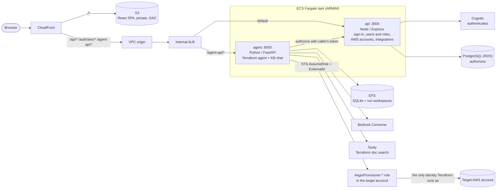

# AEGIS

**Autonomous Engine for Global Infrastructure State.** Describe infrastructure in plain language; AEGIS asks what it needs to know, writes Terraform that follows your repository's conventions, shows you the plan, and applies it to your AWS account only after you approve. Every run can open a pull request and update a Jira ticket. A knowledge base answers questions from your team's own runbooks and standards.

## How it fits together



| Folder | What it is |
| --- | --- |
| [`agent/`](agent/) | FastAPI service: the provisioning agent (`agent.py`), knowledge-base chat (`kb_chat_agent.py`), Terraform execution, GitHub/Jira delivery |
| [`api/`](api/) | Express service: Cognito token exchange, authorization from PostgreSQL, AWS account onboarding, GitHub/Jira connections |
| [`web/`](web/) | React 19 + Vite + Tailwind SPA |
| [`infra/terraform/`](infra/terraform/) | The platform's own infrastructure (`bootstrap/`, `modules/`, `environments/prod/`) |
| [`infra/onboarding/`](infra/onboarding/) | CloudFormation template that creates the AegisProvisioner role in a target account |
| [`docs/DEPLOYMENT.md`](docs/DEPLOYMENT.md) | First deploy, day-2 operations, cost and upgrade paths |

## Security model in one paragraph

Cognito proves identity; PostgreSQL (`users.role`) decides permission, re-read on every request. There are **no IAM users and no access keys** anywhere: the ECS task role is the only runtime identity, and it cannot change infrastructure itself. To provision, the api assumes an `AegisProvisioner-*` role that the user deployed in their target account, using a server-generated ExternalId, and hands the agent short-lived credentials for that one run. Terraform is started with every ambient AWS credential source stripped, so a run with no bound account fails closed. Every IAM role the agent creates must carry the `AegisBoundary` permissions boundary. Terraform state lives in the target account, in an S3 bucket the same stack creates; the provisioner role cannot weaken or empty it, and roles the agent creates cannot read it. **Check for drift** on a run compares the account with that state (read-only) and can plan the resources back to what the code says. Runs, accounts, connections and chat threads are owned by the user who created them and are invisible to everyone else.

## Local development

Prerequisites: Docker, Node 20, Python 3.11, Terraform ≥ 1.11, an AWS profile that can call Bedrock.

```bash
cp .env.example .env              # fill Cognito values (terraform output cognito) and two keys: openssl rand -hex 32
docker compose up --build         # postgres + api (:3005) + agent (:8000)
cd web && npm install && npm run dev   # http://localhost:5173 (proxies to the containers)
docker compose exec api node scripts/create-admin.js you@example.com
```

Leave the `BEDROCK_MODEL*` values blank to run the agent in mock mode.

**Just looking at the UI?** No backend, Docker, AWS or `.env` needed:

```bash
cd web && npm install && npm run demo   # http://localhost:5173, then click Sign in
```

Demo mode answers every API call from an in-memory mock (`web/demo/mockApi.ts`) and signs you in as a demo admin. Approving, sending messages, starting runs and connecting accounts all work against the mock; restarting the command resets the data. None of it is included in a normal build.

## Tests

```bash
cd agent && for t in tests/test_*.py; do python -m "tests.$(basename "$t" .py)"; done
cd api && npm run check
cd web && npm run build
terraform -chdir=infra/terraform/environments/prod validate
```

CI runs all of these on every pull request; `main` deploys to production through GitHub OIDC (see [`docs/DEPLOYMENT.md`](docs/DEPLOYMENT.md)).
